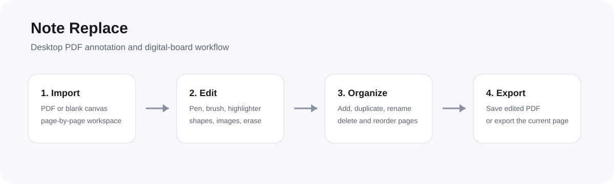

# Note Replace



**Note Replace** is a production-focused Windows/macOS/Linux desktop application for working with PDFs as an editable digital board. It is designed for people who need to import a PDF, mark it up, organize its pages, add images, and export the finished document without using a browser-based editor.

**Version:** 1.0.0  
**Developer / Copyright Owner:** Sadik Laskar  
**Copyright:** © 2026 Sadik Laskar. All Rights Reserved.  
**License:** Proprietary User License — see [`LICENSE`](LICENSE)

## What is the product?

Note Replace turns a PDF page into an editable workspace. A user can bring in an existing PDF or start with a blank canvas, annotate the page, move and resize objects, manage pages, and export the result.

The application is intended for study notes, classroom material, presentations, document review, PDF markup, handwritten annotations, and other everyday PDF editing workflows.

## Why Note Replace?

The goal is to keep PDF editing focused and fast instead of mixing the workflow with a large general-purpose design suite. The app keeps the page visible as the main workspace while the toolset stays compact and keyboard-friendly.

## Main features

- **PDF import:** Import PDF documents page by page and keep the pages editable inside the workspace.
- **Editable page canvas:** Work on the selected page as the main editing surface.
- **Drawing:** Select, Pen, Brush, Highlighter, Eraser, and Shapes.
- **Pen controls:** One compact popup for Pen/Brush type, color, and size.
- **Shapes:** Square, rounded rectangle, circle/ellipse, diamond, horizontal line, and vertical line with transparent fill and selectable borders.
- **Page management:** Add, duplicate, delete, rename, and reorder pages.
- **Images:** Import images onto the current page.
- **Undo/redo:** Recover from edits quickly.
- **Zoom:** 25%–200% working range with a 65% default zoom.
- **PDF export:** Save an edited imported PDF while preserving the document canvas dimensions.
- **PNG export:** Export the current page as an image.
- **Native projects:** Save and reopen native `.myed` project files.
- **Desktop packaging:** Windows NSIS installer plus macOS and Linux targets are configured in the build system.
- **Application identity:** The packaged application uses the Note Replace icon and identifies **Sadik Laskar** as the developer/copyright owner in the application metadata.

## Reference workflow

The image above shows the intended product flow: **Import → Edit → Organize → Export**.

## How to use

1. Start Note Replace and choose **Import PDF** or **Blank canvas**.
2. Use the page sidebar to switch between pages.
3. Use **Select** to move and resize objects.
4. Use **Pen** to open the compact pen settings and choose Pen or Brush, a color, and a size.
5. Use **Highlighter** for transparent highlighting.
6. Use **Eraser** to remove objects by clicking or dragging across them.
7. Use **Shape** to choose a shape and border color.
8. Add images when needed.
9. Use **Save** to save a native project or export changes from an imported PDF.

## Keyboard commands

| Shortcut | Action |
|---|---|
| `V` | Select |
| `P` | Pen |
| `H` | Highlighter |
| `E` | Eraser |
| `R` | Shapes |
| `Ctrl+Z` | Undo |
| `Ctrl+Y` | Redo |
| `Ctrl+S` | Save |
| `Delete` / `Backspace` | Delete selected object |
| `Esc` | Close the About/license dialog |

## Build and development

Install dependencies:

```bash
npm install
```

Run the development application:

```bash
npm run dev
```

Run tests:

```bash
npm test -- --run
```

Build the renderer and Electron code:

```bash
npm run build
```

Create the Windows NSIS installer:

```bash
npm run dist:win
```

The Windows installer is generated under `release/`.

## Production and security notes

The renderer runs without Node integration and uses isolated Electron preload IPC. PDF imports are processed progressively, page images are optimized before being stored in editor state, and background PDF hydration does not create undo-history entries.

The repository is **not an open-source project**. The application may be used according to the proprietary user license, but the repository, source code, UI implementation, assets, and architecture may not be copied, forked, repackaged, redistributed, or used as the basis of another product without written permission from Sadik Laskar.

## License and ownership

Copyright © 2026 **Sadik Laskar**. All Rights Reserved.

The application is distributed under a **Proprietary User License**. Authorized users may use an unmodified build of Note Replace and may create/export their own documents. The license does not grant ownership of the source code or repository and does not permit unauthorized copying, forking, redistribution, reverse engineering, rebranding, or creation of derivative software.

Read the complete terms in [`LICENSE`](LICENSE).

For written permission or commercial licensing outside the granted user rights, contact:

**Sadik Laskar**  
`emailme.sadik@gmail.com`
